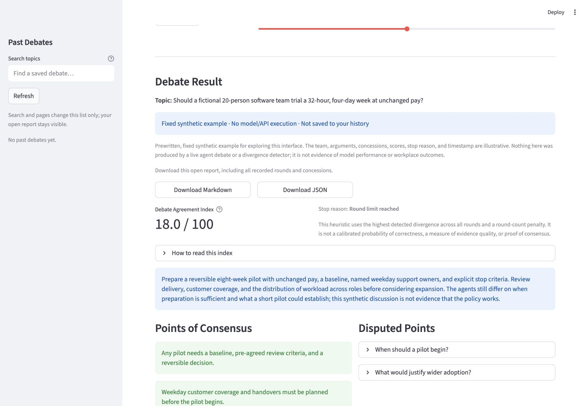
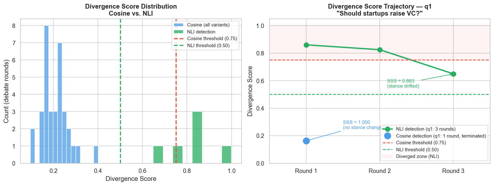

# 多智能体辩论系统

[](https://github.com/xyma2003/multi-agent-debate/actions/workflows/ci.yml)
[](https://www.python.org/)
[](LICENSE)

[English](README.md)

**看见三方争在哪里，也看见哪条论点改变了立场。**

这是一个基于 LangGraph 的应用，把独立观点、有上限的多轮反驳、带归因的让步和最终结论串成可查看、可导出的报告。三个角色分别是乐观分析者、风险分析者和框架挑战者；界面中后者显示为 Devil's Advocate。

[打开案例](docs/CASE_STUDY_zh.md) · [阅读完整报告](docs/example-report.md) · [无密钥体验](#快速开始) · [证据与限制](#实验结论应如何理解)



当前界面打开内置的**固定合成样例**。内容与分数均为预先编写的演示设置；截图不代表实时模型结果，也不作为模型效果证据。

## 一个问题，三种视角

**一个虚构的 20 人软件团队，是否应该在薪资不变的情况下，试行每周 32 小时的四天工作制？**

| 视角 | 最初立场 | 反驳后的立场 |
|---|---|---|
| 乐观分析者 | 开始八周、可撤回的试点 | 先明确工作日客户支持负责人和复盘标准 |
| 风险分析者 | 准备完成前保留现有安排 | 有代表性基线、排班演练后，可以接受试点 |
| 框架挑战者 | 先明确休息时间与值班责任如何公平分配 | 按岗位取得共识，并检查各岗位的负担 |

样例记录了两条带归因的让步、有条件的建议，以及对启动时机和扩大实施范围的剩余分歧。[案例说明](docs/CASE_STUDY_zh.md) 把每次变化与触发论点连起来；[完整报告](docs/example-report.md) 包含六段原始英文论证，可直接在 GitHub 阅读，无需安装。

## 快速开始

需要 Python 3.10+。只有发起新辩论时需要 LLM API 密钥，查看内置样例和已保存的报告无需配置凭据。

```bash
git clone https://github.com/xyma2003/multi-agent-debate.git
cd multi-agent-debate

python3 -m venv .venv
source .venv/bin/activate          # Windows: .venv\Scripts\activate
pip install -r requirements.txt

streamlit run app.py
```

浏览器访问 <http://localhost:8501>，点击 **View offline example**。即使全新检出，也能查看虚构团队是否试行四天工作制的两轮讨论，包括完整论证、关键论点、共识、剩余分歧和带归因的让步。展开 **Full Reasoning Trace** 和 **Concession Log** 即可追溯讨论过程。

[内置样例](examples/offline_debate.json) 是预先编写的固定合成演示，不是实际运行辩论流程的产物，也不作为模型效果证据。分歧值、自报信心和时间戳均为演示设置，报告指数按文档中的公式计算。查看样例不会调用 API、下载本地模型或把样例写入 **Past Debates**；已有报告仍从侧栏单独选择。配置凭据前 **Start Debate** 按钮保持禁用。

### 查找已保存的辩论

在侧栏 **Past Debates** 中，用 **Search topics** 按议题文字搜索，或用
**Previous / Next** 翻页，每页十条，较新的报告在前。时间与报告 ID 用于区分同题报告。
更换关键词会回到第一页，**Clear search** 恢复完整列表，**Refresh** 重新读取历史。
搜索只匹配议题中的连续文字，不搜索报告正文；`%`、`_` 按普通字符处理。

搜索和翻页只改变侧栏列表，已经打开的报告继续保留，并显示自己的保存时间和 ID，
选择另一条报告后才切换正文。记录缺失或无法读取时会提示，并保留当前报告。
历史浏览无需 API 凭据，不重新调用模型、不改写报告；辩论运行期间暂停历史导航。

### 导出当前报告

在 **Debate Result** 下点击 **Download Markdown** 下载可读报告，或点击
**Download JSON** 下载结构化数据。两种格式都包含报告 ID、原始时间、结论、共识、
分歧、每轮完整论证与关键论点，以及全部让步记录；使用 UTF-8 编码，保留中文。
搜索和翻页不会改变下载内容，打开另一份报告后才会切换。

JSON 包含 `schema_version`、`source`、`interpretation` 和 `report`；
`report` 保存完整的 `DebateReport` 数据，兼容字段 `confidence_score` 保持原有
0–1 数值，不重新计算。报告一致性指数与角色自报信心都不是校准后的正确率；
导出不会用当前配置推断报告使用的分歧检测器。固定样例的两种导出均保留合成演示
标记与来源说明。下载无需 API 凭据，不调用模型、不写入历史。报告生成后即使
数据库保存失败，也能查看和下载；这时导出会明确标记保存尚未确认。

点击 **Retry save** 可重试保存同一份报告，无需重新辩论或配置 API 凭据。
浏览历史和样例不会丢掉待保存报告，点击 **View unsaved report** 即可返回。
保存成功或明确点击 **Discard unsaved report** 放弃后，才能开始新辩论。
恢复仅限当前浏览器会话；刷新、关闭页面或重启服务前，请先下载备份。下载本身不会
把报告写入历史。

发起新辩论会调用所配置的 LLM API。默认 NLI 模式首次执行分歧检测时会下载 `cross-encoder/nli-deberta-v3-small`（约 180 MB）；可选的余弦对照模式会下载 `BAAI/bge-small-en-v1.5`（约 130 MB）。

### 最终总结生成状态

报告用 `synthesis_status` 单独记录总结状态，不改变讨论停止原因或一致性指数。
`complete` 表示成功解析了最终总结；`failed` 表示原有尝试次数耗尽，只留下兜底内容。
这时仍能查看原始讨论，但空的共识、分歧栏不能理解为“没有共识”或“没有分歧”。
旧报告与固定样例缺少该字段时显示 `unknown`，页面和导出明确说明未记录，不根据
结论文字猜测。保存成功不代表总结生成成功；生成成功也不保证内容正确。

### 配置示例

需要发起新辩论时，将 `.env.example` 复制为 `.env`（已有文件则直接编辑），把占位内容替换为自己的凭据并重启应用。`.env.example` 包含全部后端配置。SiliconFlow/OpenAI-compatible 的最小配置如下：

```dotenv
LLM_BACKEND=openai
OPENAI_API_KEY=sk-...
OPENAI_API_BASE=https://api.siliconflow.cn/v1
OPENAI_MODEL=Qwen/Qwen3-32B
DIVERGENCE_MODE=nli
```

支持 `openai`、`anthropic`、`groq`、`qwen`、`cerebras`、`together`、`sambanova` 和 `gemini`。

## 系统流程

```text
问题
  └─► 初始化
       └─► 乐观分析者 ─┐
           风险分析者   ├─► 汇总 ─► 分歧检测
           框架挑战者 ─┘                  │
                   ┌─ 无矛盾/达到上限 ─► 综合报告 ─► 保存
                   └─ 检测到矛盾 ─► 下一轮反驳 ─┘
```

正式应用默认使用 NLI 矛盾检测决定是否进入下一轮。轻量的余弦模式仍作为对照保留，但不应被视为可靠的立场检测器。

最终 `DebateReport` 包含共识点、争议点、结论、辩论一致性指数、完整轮次轨迹，以及每次让步对应的触发 Agent 和具体论点。这个指数是对检测到的分歧所作的启发式计算，不是结论正确的概率。

- LangGraph 并行 fan-out/fan-in 与有界循环编排
- Pydantic 结构化输出及解析失败降级
- 基于 NLI 的矛盾检测与调用方轮数上限
- 公式计算的辩论一致性指数和带来源的让步记录
- SQLite 持久化、Streamlit 历史搜索与 Markdown/JSON 导出
- 面向提示词和路由策略消融的实验流水线

## 关键设计

| 设计 | 原因 |
|---|---|
| 方法论角色 | Agent 获得可执行的分析流程，而不只是性格标签 |
| 默认 NLI 路由 | 检测逻辑矛盾，而非共享词汇带来的话题相似性 |
| 检测器自行判断分歧对 | 避免用同一阈值比较余弦距离与 NLI 概率 |
| 用户轮数上限 + 绝对安全上限 | 遵守 `max_rounds`，同时防止无限循环 |
| 辩论一致性指数 | 启发式计算过程可检查，不让 LLM 临时编造分数 |
| 让步归因 | 记录哪个论点改变了哪个立场及其原因 |

## 如何理解辩论一致性指数

报告中的 **Debate Agreement Index（辩论一致性指数）** 是启发式指标，显示为 **18.0 / 100**，不使用百分比：

```text
辩论一致性指数 = 100 ×（1 − 全部轮次中的最高分歧值）× 轮数系数
轮数系数：1 轮 → 1.0；2 轮 → 0.9；3 轮及以上 → 0.8
```

例如，两轮分歧值为 `[0.8, 0.2]`，指数为 `100 × (1 − 0.8) × 0.9 = 18.0 / 100`。公式保留整个过程的最高分歧，不会因为最后一轮降到 0.2 就变成 72.0。轮数系数是预先设定的规则，不是实验测得的辩论轮数与答案质量之间的关系。

**高分不代表答案正确、证据充分或真正达成共识。** 它不是经过校准的答案正确率概率，也不衡量 Agent 改进了多少或最终有多一致。即使没有检测到分歧，证据也可能不足。停止原因是另一个概念：`converged` 只表示当前检测器未标记分歧 Agent 对，不表示结论已经过事实核验。

NLI 模式对每个 Agent 对取 claim 组合中的最高矛盾概率，再求均值得到该轮分歧；低矛盾也可能只是中立或互不相关。余弦模式衡量语义接近程度，立场相反的论点也可能很接近。不同模式的指数不能直接比较。新报告逐轮保存实际使用的检测器配置；缺少元数据的旧报告保持 **unknown（未知）**，不能用当前设置反推历史分数所用的检测器。

每个 Agent 的 **self-reported confidence（自报信心）** 表示它对自身立场的信心，同样未经校准；它与报告指数独立，也不参与上述公式。为兼容历史记录，底层字段仍叫 `confidence_score`，保留原有的 0–1 数值和计算方法；界面仅将其乘以 100 展示。

## 测试

```bash
pip install -r requirements-dev.txt

# CI 使用的确定性测试；不下载模型、不调用 API
python -m pytest -m "not integration and not model" -q

# 以下按需运行
python -m pytest -m model -v        # 下载本地嵌入/NLI模型
python -m pytest -m integration -v  # 需要 API 凭据
python -m pytest -m ui -v           # 离线 Streamlit UI 测试，已纳入 CI
```

## 实验结论应如何理解

仓库中的实验用于工程探索，不是发表级研究证据。样本量较小，多数问题只运行一次，部分质量评测依赖单一 LLM judge。

干净的基础对比每个系统包含 **10 个匹配问题**。表中的历史多 Agent 运行使用**余弦路由**，不是当前应用默认的 NLI 路由：

| 系统 | n | PDS | 对冲率 | 平均轮数 |
|---|---:|---:|---:|---:|
| 修正后的框架挑战者 | 10 | 0.2242 | 0.0093 | 1.00 |
| 单 LLM 基线 | 10 | 0.2160 | 0.0129 | 1.00 |
| 旧版挑战者提示词 | 10 | 0.1707 | 0.0077 | 1.00 |

在这组样本中，修正后的提示词获得了高于旧提示词的 PDS；多 Agent 输出的平均对冲率比单 LLM 基线低约 28%。这些是本次样本中的观察值，不代表已经证明了可泛化的因果提升。

PDS 根据论点的嵌入向量衡量不同角色的表达差异；对冲率是匹配到的对冲表达数与词数的比值；立场稳定性 SSS 用嵌入相似度比较同一角色首轮与末轮的立场。它们都是描述性指标，不能证明答案正确、证据充分或不存在迎合。对冲表达减少，也可能同时减少合理的不确定性表达。

另一组规范化 NLI 运行包含 **7 个问题**：**4/7** 进入多轮，平均轮数为 **2.14**，平均立场稳定性为 **0.9772**。它与基础对比是不同批次，不能据此估计路由改变带来的因果收益。规范数据文件、验证失败剔除、judge 限制和来源缺口详见 [`results/README.md`](results/README.md)。上面的固定离线样例不计入这些实验。



该图是历史探索性可视化，需结合上述样本量和来源说明解读。无需调用模型即可复算仓库现有结果：

```bash
python benchmark/summarize_results.py
```

重新运行实验：

```bash
python benchmark/run_experiment.py \
  --variants full_system single_llm nli_detection \
  --limit 10 --max-rounds 3 --delay 30
```

模型实验需要下载、凭据、时间和费用，因此不放入 CI。
benchmark 会显式固定各变体的检测器，因此即使生产应用默认 NLI，余弦基线与 NLI 消融仍保持不同语义。

## 已知局限

- 问题集规模较小且非随机抽样，多数变体每题只有一次运行
- LLM-as-judge 会受到 judge 模型和评分规则影响
- 余弦模式只能衡量语义接近程度，不能可靠判断立场对立
- NLI 增加本地模型下载和推理成本
- 辩论一致性指数是启发式指标，不是经过校准的答案正确率概率，也不能证明共识
- 强制立场可能同时压制空洞对冲和合理的不确定性表达
- 缺少检测器元数据的旧报告仍显示未知；保存的模型 ID 只标识加载器配置，不代表已锁定模型权重版本

## 项目结构

```text
app.py                         Streamlit 界面
debate/                        图、数据模型、提示词、路由、持久化
examples/offline_debate.json    固定合成报告与来源说明
docs/                          案例说明、导出样例与界面截图
benchmark/                     实验运行器、变体和评测器
results/                       原始输出与数据口径说明
analysis/                      notebook 与实验图
tests/                         确定性、模型、UI 和集成测试
.github/workflows/ci.yml       确定性 CI
PAPER.md                       探索性研究风格报告
BLOG_EN.md / BLOG_ZH.md        工程复盘长文
```

## 可观测性

LangSmith 追踪为可选配置，可在 `.env` 中加入：

```dotenv
LANGCHAIN_TRACING_V2=true
LANGCHAIN_API_KEY=ls-...
LANGCHAIN_PROJECT=multi-agent-debate
```

追踪可能包含完整提示词和输出。处理敏感议题前，应先检查相应的数据处理要求。

## 维护与参与

当前应用已提供内置离线样例、历史搜索和 Markdown/JSON 导出。维护重点是可靠地查看与回放报告、兼容旧数据，以及确定性回归验证。需要模型的实验仍与 CI 分开执行；现有报告和实验结果仍受[已知局限](#已知局限)与[数据来源说明](results/README.md)约束。

### 已保存的检测器配置

每轮新辩论保存检测模式、模型 ID、输入字段、判定分歧的阈值、适用的快速收敛阈值或 NLI 标签索引、sentinel 过滤策略，以及实际评估的 Agent 对数量。这些信息在计算处捕获，保存在 `reasoning_trace[].detector_metadata`，随报告组装、SQLite 存储、历史回看及 Markdown/JSON 导出保留。配置区逐轮展示，能够区分不同轮次使用不同检测器的情况。

评估对数为 0 表示该轮没有执行成对模型推理。实验变体仍显式选择自己的 NLI/余弦检测器，不受应用默认模式影响；全文变体记录 `reasoning` 输入与 sentinel 过滤策略。计算公式与已有分数保持不变。模型 ID 不代表权重版本已固定，也不能证明模型效果。

缺少字段的旧 JSON 仍可加载，显示 **unknown（未知）**；不会从当前环境补齐、不因浏览改写历史，内置合成样例继续保留未知检测器与合成来源标记。此次只增加可选报告字段，无需迁移数据库或补写历史。

回归检查与参与入口：

| 任务 | 代码与验证入口 | 验收标准 |
|---|---|---|
| 捕获与持久化 | [模型定义](debate/state.py)、[检测与存储检查](tests/test_detector_metadata.py)、[实验变体检查](tests/test_detector_benchmark_metadata.py) | 用固定模型输出核对原有分数、判定与实际配置，覆盖零次评估；新旧报告均能从 SQLite 读取。不下载模型或执行真实推理。 |
| 回看与导出 | [界面](app.py)、[序列化](debate/export.py)、[导出测试](tests/test_report_export.py)、[离线 UI 测试](tests/test_phase5.py) | 改变当前设置后，页面、Markdown、JSON 仍保留原配置与分数；未知轮次和合成来源明确，浏览与导出不调用模型、不改写历史。 |

### 提交问题或改动

请提供操作系统、Python/依赖版本、提交版本、最小复现步骤、期望与实际行为，以及已经执行的检查。需要数据时，使用小型合成报告。PR 中说明相关离线测试和[确定性套件](#测试)的结果，并明确是否调用过模型/API 或下载过模型。不要上传 API 密钥、`.env` 文件或私人报告内容。

[提交 Issue](https://github.com/xyma2003/multi-agent-debate/issues) 或 [提交 Pull Request](https://github.com/xyma2003/multi-agent-debate/pulls)。

MIT License。
