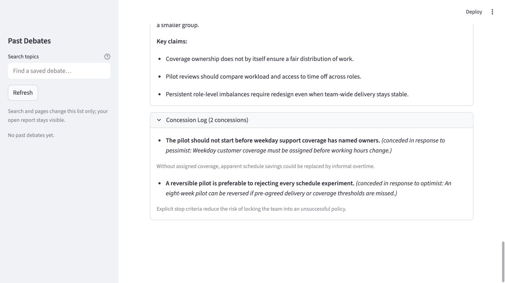

# 一个议题，两轮讨论，一份可追溯报告

[English case](CASE_STUDY.md) · [返回项目](../README_zh.md) · [完整报告](example-report.md) · [导出 JSON](example-report.json)

本文解读仓库中的[固定合成样例](../examples/offline_debate.json)。论证、让步、分数、停止原因和时间戳均为预先编写的演示内容，用来展示如何查看报告；它不是实时模型运行结果，也不能证明某种工作制度有效。下文为中文摘要，原始报告保留英文。

## 讨论的问题

> 一个虚构的 20 人软件团队，是否应该在薪资不变的情况下，试行每周 32 小时的四天工作制？

场景设定包含工作日客户支持，以及不同岗位的职责差异。需要决定的是“是否试点、如何试点”。样例没有提供真实的实施效果数据。


截图录于 **2026-10-16**，使用应用基线 `e80df34`、内置样例和空临时历史库。没有配置凭据、执行模型或下载检测器；打开样例后，历史库仍为空。

## 观点如何变化

下表概括报告保存的六段完整论证。框架挑战者对应 `devil` 角色，在界面中显示为 Devil's Advocate。

| 视角 | 第一轮 | 第二轮 |
|---|---|---|
| 乐观分析者 | 开始八周、可撤回的试点，观察交付、客户支持和工作负担。 | 启动前明确支持负责人和复盘标准，并检查各岗位的负担。 |
| 风险分析者 | 客户支持与衡量方案未准备好之前，保留现有安排。 | 有代表性基线并完成客户支持排班演练后，可以接受可撤回的试点。 |
| 框架挑战者 | 先明确休息时间与值班责任如何公平分配。 | 按岗位取得共识，检查谁承担交接工作和不理想的休息日安排。 |

在应用中展开 **Full Reasoning Trace**，可以查看每段立场、完整论证、关键论点、自报信心和当轮让步。[导出的完整报告](example-report.md#reasoning-trace) 也保留了两轮中的全部三个角色。

## 两条有来源的让步

报告同时保存立场变化，以及触发变化的前轮具体论点。

1. **乐观分析者增加启动前提。** 风险分析者第一轮提出：“改变工时之前，必须明确工作日客户支持由谁负责。”乐观分析者因此接受，试点应等待支持负责人确定后再开始；否则表面的工时节省可能被隐性加班抵消。
2. **风险分析者接受有边界的试验。** 乐观分析者第一轮提出：“如果未达到事先约定的交付或覆盖标准，可以撤回八周试点。”风险分析者因此接受，可撤回的试点比拒绝所有试验更合理，因为明确的停止标准降低了团队被失败方案长期绑定的风险。



**Concession Log** 展示原始英文论点与让步原因。同样的记录也保留在对应的第二轮论证和导出的全局日志中。读者可以沿着这些记录检查，让步是否回应了所引用的论点。

## 最终结论与仍未解决的分歧

最终建议是：先准备一个薪资不变、为期八周且可撤回的试点，明确基线、工作日支持负责人和停止标准；考虑扩大范围前，检查交付、客户支持以及各岗位的负担分配。

报告仍保留两类分歧：

- **什么时候算准备好了：** 乐观分析者强调负责人和复盘标准；风险分析者进一步要求有代表性基线与排班演练；框架挑战者要求按岗位取得共识。
- **试点能支持多大的结论：** 短期试点可以帮助决定是否继续试验，但未必覆盖季节性高峰，也可能掩盖部分岗位承担的不公平负担。

保存的停止原因是 `max_rounds`，界面显示为 **Round limit reached**。它不表示所有分歧已经解决，也不表示建议通过了事实验证。

## 为什么是 18.0 / 100

样例人为设置的两轮分歧值为 `0.8` 和 `0.2`。报告按文档公式取两轮中的最高值：

```text
100 × (1 − max(0.8, 0.2)) × 0.9 = 18.0 / 100
```

这是 **Debate Agreement Index（辩论一致性指数）**，不是“答案正确的概率为 18%”。样例中的数值没有经过检测器计算；角色自报信心同样是演示设置，也不参与该公式。检测器与历史报告的更多限制见[完整指标说明](../README_zh.md#如何理解辩论一致性指数)。

## 打开同一个案例

完成[安装步骤](../README_zh.md#快速开始)后，运行 `streamlit run app.py`，点击 **View offline example**，无需 API 密钥。展开 **Full Reasoning Trace**、**Concession Log** 和争议点面板，再用 **Download Markdown** 或 **Download JSON** 保存报告。

查看和导出样例不执行辩论图、不下载模型，也不把样例写入 **Past Debates**。发起新的辩论是另一项操作，需要配置凭据。

仓库中的 [Markdown](example-report.md) 与 [JSON](example-report.json) 由应用的 `build_report_exports(..., source="sample", provenance=...)` 从 `examples/offline_debate.json` 生成，保留原始报告数值和合成来源标记。JSON 的版本封装与应用下载一致。
